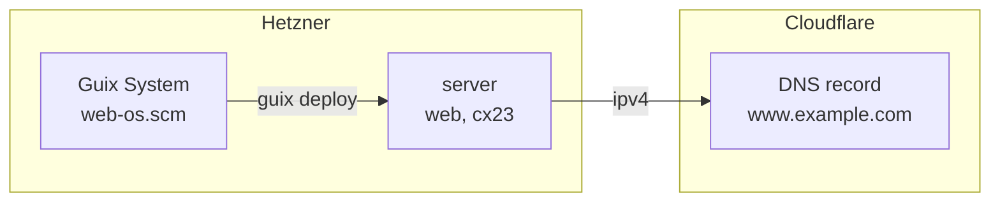
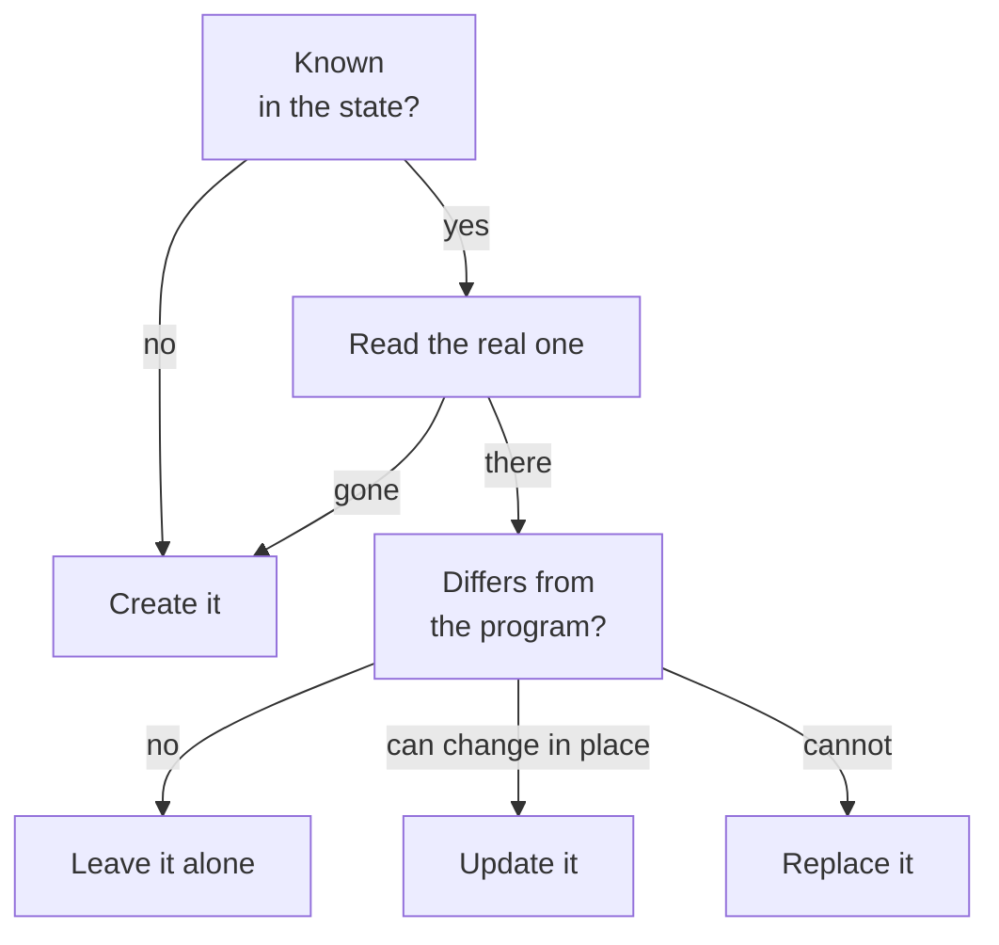
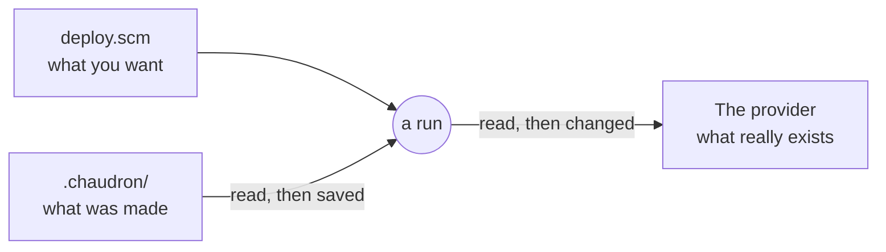

<p align="center">
  
</p>

<h1 align="center">chaudron</h1>

<p align="center">
  The cloud and the machines, in one program.<br>
  <a href="https://chaudron.dev">chaudron.dev</a> ·
  <a href="https://chaudron.dev/docs/">Documentation</a> ·
  <a href="https://chaudron.dev/docs/load-balancer/">Recipes</a>
</p>

chaudron is a Guile library. Servers at Hetzner or Oracle, records at
Cloudflare, and the Guix System that runs on the servers are declared in the
same Scheme program, and deployed by running it. There is no CLI and no plan
to apply: each resource call converges the real resource right away, then
returns it, with outputs such as its address for the next calls.

## One program, two providers, one system

```scheme
;; deploy.scm
(use-modules (chaudron) (chaudron hetzner) (chaudron cloudflare))

(with-stage "prod"
  (define key
    (hetzner-ssh-key "me" #:public-key-file "~/.ssh/id_ed25519.pub"))

  ;; A server at Hetzner,
  (define server
    (hetzner-server "web" #:type "cx23" #:location "fsn1"
                    #:ssh-keys (list key)))

  ;; running the system of web-os.scm,
  (hetzner-guix-system "web" #:server server
                       #:os "web-os.scm" #:ssh-key key)

  ;; with its address at Cloudflare.
  (cloudflare-dns-record "www" #:zone "example.com"
                         #:content (output server 'ipv4)))
```

```scheme
;; web-os.scm: the whole system of the server, in the same language.
(use-modules (gnu) (gnu machine hetzner))
(use-service-modules web)

(define %base (make-hetzner-os "cx23"))

(operating-system
  (inherit %base)
  (host-name "web")
  (services
   (cons (service nginx-service-type
                  (nginx-configuration
                   (server-blocks
                    (list (nginx-server-configuration
                           (listen '("80" "[::]:80"))
                           ;; public/, copied with the system.
                           (root (local-file "public" "site"
                                             #:recursive? #t)))))))
         (operating-system-user-services %base))))
```



```
$ guile deploy.scm
chaudron: create hetzner-ssh-key/me
chaudron: create hetzner-server/web
chaudron: create hetzner-guix-system/web
chaudron: 203.0.113.7: deploying web-os.scm
chaudron: create cloudflare-dns-record/www
```

About eight minutes later, `www.example.com` serves `public/` from a fresh
Guix System. The address Hetzner gave the server went to Cloudflare as a
plain value. [The whole recipe](https://chaudron.dev/docs/static-site/)
was tested on Hetzner and Cloudflare.

## Run it again

- **Nothing changed:** nothing happens.
- **You changed an argument:** the resource is updated in place, or
  replaced when it cannot change in place, such as a server's image.
- **You removed a resource from the program:** it is deleted.
- **Someone changed it by hand,** in the console: the next run reports the
  drift and undoes it.
- **You only want to see:** `#:dry-run? #t` runs the same program and
  reports what it would do, changing nothing.



If the program fails halfway, nothing is deleted: a half-run program cannot
take down what it did not reach.

## What it manages

| Provider | Resources |
|---|---|
| [Hetzner Cloud](https://chaudron.dev/docs/hetzner/) | servers, SSH keys, firewalls, primary IPs, volumes, networks, load balancers, snapshots |
| [Oracle Cloud](https://chaudron.dev/docs/oracle/) | instances, networks, buckets, files, images imported from them |
| [Cloudflare](https://chaudron.dev/docs/cloudflare/) | DNS records, Workers, KV namespaces, D1 databases |
| [Guix System](https://chaudron.dev/docs/guix-system/) | installed on Hetzner servers, or started on Oracle Cloud from an image, then deployed with `guix deploy` |
| [Livebox](https://chaudron.dev/docs/livebox/) | port forwards and DHCP leases of an Orange Livebox, experimental |

A provider is a module with four procedures, of which only `create` and
`delete` are required: see
[Writing a provider](https://chaudron.dev/docs/writing-a-provider/).

## Getting started

With Guix, a project says which chaudron it uses in its own `channels.scm`,
pins the exact versions in a lock, and runs with them. Nothing is installed
globally.


```scheme
;; channels.scm
(cons (channel
       (name 'chaudron)
       (url "https://github.com/prop4n/chaudron")
       (branch "main")
       (introduction
        (make-channel-introduction
         "86088179a3b0db539f47047c2dfe12d1d62b353d"
         (openpgp-fingerprint
          "4707 DBF9 AD31 C133 DC3D  E410 822B CCA9 C126 8873"))))
      %default-channels)
```

```sh
guix time-machine -C channels.scm -- describe -f channels > channels.lock.scm
guix time-machine -C channels.lock.scm -- shell guile chaudron -- guile deploy.scm
```

The introduction lets Guix check that every commit it fetches is signed by
chaudron's authors. Commit `channels.lock.scm`: the same program then gives
the same result, next year too. Run the first command again to move to
newer versions.

On Debian or Ubuntu, without Guix:

```sh
sudo apt install guile-3.0 guile-json guile-gnutls guile-gcrypt
git clone https://github.com/prop4n/chaudron ~/src/chaudron
GUILE_LOAD_PATH=~/src/chaudron/lib guile deploy.scm
```

Tokens come from the environment, or from a `.env` file read with
`load-env-file`, kept out of git:

| Provider | Variables |
|---|---|
| Hetzner Cloud | `HCLOUD_TOKEN` |
| Cloudflare | `CLOUDFLARE_API_TOKEN` |
| Oracle Cloud | `OCI_USER`, `OCI_TENANCY`, `OCI_FINGERPRINT`, `OCI_REGION`, `OCI_KEY_FILE`, `OCI_COMPARTMENT` |

[Installation](https://chaudron.dev/docs/installation/) explains each step,
and [Your first deployment](https://chaudron.dev/docs/first-deployment/)
goes from nothing to `ssh` on a server at Hetzner.

## Recipes

Complete programs, with what to expect when you run them.

- **Hetzner:** [web servers behind a load balancer](https://chaudron.dev/docs/load-balancer/),
  [replace a server, keep its address](https://chaudron.dev/docs/keep-an-address/),
  [staging and production](https://chaudron.dev/docs/staging-and-production/),
  [two servers on a private network](https://chaudron.dev/docs/private-network/),
  [data on a volume](https://chaudron.dev/docs/volume/)
- **Cloudflare:** [a static site](https://chaudron.dev/docs/cloudflare-static-site/),
  [an API on Workers, with KV and D1](https://chaudron.dev/docs/workers-api/),
  [a Worker on a schedule](https://chaudron.dev/docs/scheduled-worker/)
- **Oracle Cloud:** [a free Arm server](https://chaudron.dev/docs/oracle-arm-server/),
  [files to download from a bucket](https://chaudron.dev/docs/oracle-downloads/),
  [an Oracle server, named at Cloudflare](https://chaudron.dev/docs/oracle-cloudflare/)
- **Guix System:** [a static site on Hetzner](https://chaudron.dev/docs/static-site/),
  [from an image on Oracle Cloud](https://chaudron.dev/docs/oracle-guix-system/)

## What chaudron keeps



Each run compares three things: the program says what is wanted, the state
says what chaudron made, the provider says what exists now. The state is
`.chaudron/`, one small s-expression file per resource, read as data and
never evaluated. Commit it, or keep it somewhere safe: without it, chaudron
would create everything again.

## Repository

| Directory | |
|---|---|
| `lib/` | the library and its tests |
| `examples/` | programs to start from: a server, a static site, Guix System, a Livebox |
| `site/` | [chaudron.dev](https://chaudron.dev), built with Haunt and deployed with chaudron itself |

## Development

From `lib/`:

```sh
guix shell -m manifest.scm
guile -L . tests/run.scm
```

Each file can also be run alone, such as `guile -L . tests/stage.scm`. The
tests run against fake APIs and fake commands: they need no account and
cost nothing.

## Status

chaudron is young: its interface may still change.

## License

chaudron is free software, under the GNU General Public License, version 3
or any later version. See [COPYING](COPYING).
