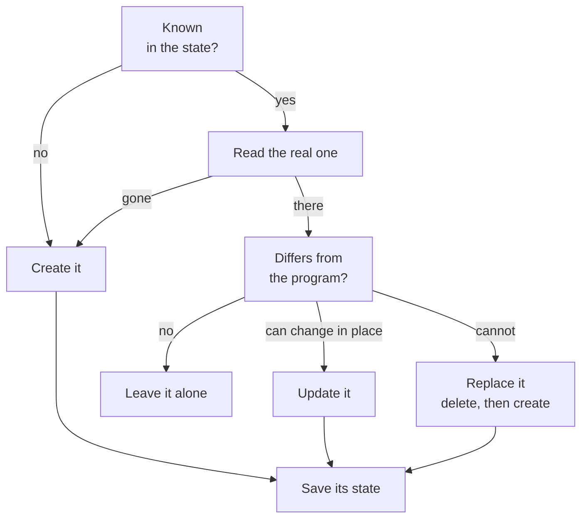

title: Resources
order: 2
description: Declaring resources, using their outputs, and what each call does.
---

A resource call, like `hetzner-server` or `cloudflare-dns-record`, takes a
name and keyword arguments, and returns the resource once it matches them.

```scheme
(define forge
  (hetzner-server "forge" #:type "cx23" #:location "fsn1"))
```

The name identifies the resource within its kind and its stage: declaring
the same one twice in a run is an error.

## Outputs

What the provider learns about a resource, its id, its address, is in its
outputs:

```scheme
(output forge 'ipv4)                    ;"203.0.113.7"
```

Each resource page lists the outputs it has. During a
[dry run](/docs/dry-runs/), the outputs of resources that do not exist yet
are unknown.

## Giving resources to others

A resource can be given to another one: it stands for its `id`. chaudron
then knows that the second depends on the first, and deletes them in the
right order.

```scheme
(define data (hetzner-volume "data" #:size 10 #:location "fsn1"))

(hetzner-server "forge" #:type "cx23" #:location "fsn1"
                #:volumes (list data))
```

An output given with `output` is a plain value: it carries no dependency.

## What a call does

1. If chaudron knows the resource, it reads the real one, when its provider
   can. If it was deleted behind chaudron's back, it is created again. If it
   was changed, the change is reported, then undone:

   ```output
   chaudron: hetzner-server/forge has drifted: type is "cx33", expected "cx23"
   chaudron: update hetzner-server/forge (type)
   ```

2. It compares the resource with what the program says, and then:
   - creates it, if it does not exist;
   - updates it in place, if what changed can change in place;
   - replaces it, deleting it then creating it again, if not; each resource
     page says which changes replace it;
   - leaves it alone, if nothing changed.
3. It saves the state of the resource immediately, so that an interrupted
   run loses nothing.



Every change is reported on the error port, with the arguments that caused
it:

```output
chaudron: create hetzner-volume/data
chaudron: update hetzner-server/forge (volumes)
chaudron: replace hetzner-ssh-key/me (public-key)
chaudron: delete hetzner-firewall/web
```
