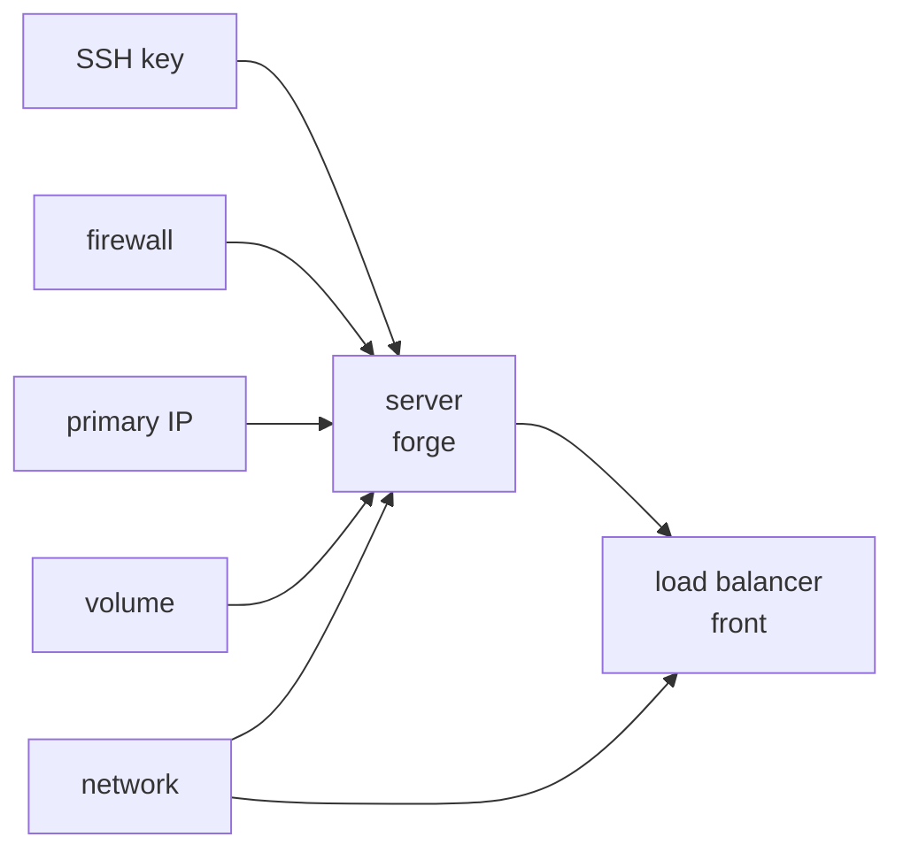

title: Hetzner Cloud
order: 1
description: Servers, SSH keys, firewalls, IPs, volumes, Storage Boxes, networks, load balancers and snapshots.
---

```scheme
(use-modules (chaudron) (chaudron hetzner))
```

## Setup

Create a token in the [Hetzner Console](https://console.hetzner.cloud):
open the project, then **Security**, **API tokens**, with **Read & Write**
permissions. chaudron reads it from `HCLOUD_TOKEN`, or from
`with-hetzner`:

```scheme
(with-hetzner token
  (with-stage "prod" ...))
```

See [Credentials](/docs/credentials/) for the other ways to give it. The
same token manages the project's [Storage Boxes](#hetzner-storage-box),
which are not in the Hetzner Cloud API but in the Hetzner API.

## A complete example

```scheme deploy.scm
(with-stage "prod"
  (define key
    (hetzner-ssh-key "me" #:public-key-file "~/.ssh/id_ed25519.pub"))

  (define web
    (hetzner-firewall "web"
                      #:rules (list (allow-in 'tcp 22)
                                    (allow-in 'tcp 443)
                                    (allow-in 'tcp "8000-8100"
                                              #:from '("10.0.0.0/8"))
                                    (allow-in 'icmp))))

  (define ip   (hetzner-primary-ip "forge" #:location "fsn1"))
  (define data (hetzner-volume "data" #:size 20 #:location "fsn1"))
  (define lan  (hetzner-network "lan" #:ip-range "10.0.0.0/16"))

  (define forge
    (hetzner-server "forge"
                    #:type "cx23"
                    #:location "fsn1"
                    #:ssh-keys (list key)
                    #:firewalls (list web)
                    #:ipv4 ip              ;keeps its address when replaced
                    #:volumes (list data)  ;mounted under /mnt
                    #:networks (list lan)
                    #:backups? #t
                    #:protected? #t))

  (hetzner-load-balancer "front"
                         #:location "fsn1"
                         #:services (list (forward 'http 80 #:to 8080))
                         #:targets (list forge)
                         #:network lan))
```



Each arrow is a resource given to another: chaudron makes them in this
order, and deletes them the other way round.

## What every resource shares

- **Names.** At Hetzner, a resource is named after its resource name and
  its stage, `forge-prod` for `forge` in `"prod"`, so that stages can share
  a project. `#:name` sets another name.
- **Labels.** `#:labels`, an association list of strings, sets your own
  labels, such as `'(("role" . "web"))`. chaudron adds `chaudron/stage` to
  every resource.
- **Protection.** `#:protected? #t` makes Hetzner refuse to delete the
  resource, and to rebuild a server, including through chaudron: turn it
  off before deleting it.

## hetzner-server

A server.

| Argument | Default | |
|---|---|---|
| `#:type` | required | the server type, such as `"cx23"` |
| `#:location` | required | such as `"fsn1"`, `"nbg1"` or `"hel1"` |
| `#:image` | `"debian-12"` | an image name, or a [snapshot](#hetzner-snapshot) |
| `#:ssh-keys` | `'()` | [SSH keys](#hetzner-ssh-key) for root |
| `#:firewalls` | `'()` | [firewalls](#hetzner-firewall) |
| `#:volumes` | `'()` | [volumes](#hetzner-volume), mounted under `/mnt` |
| `#:networks` | `'()` | private [networks](#hetzner-network) |
| `#:ipv4`, `#:ipv6` | new addresses | [primary IPs](#hetzner-primary-ip) |
| `#:user-data` | none | a cloud-init configuration |
| `#:backups?` | `#f` | daily backups by Hetzner |
| `#:labels`, `#:protected?`, `#:name` | | see above |

Outputs: `id`, `ipv4`, `ipv6`, `private-ipv4`.

Changing the location or the image **replaces** the server, losing the
data on its disk, but not its volumes, and not its address if it has a
primary IP. Everything else changes in place:

- changing the type or the primary IPs powers the server off for a moment;
  its disk is not grown, so that it can be downgraded again;
- `#:ssh-keys` and `#:user-data` are only used when the server is created;
- `#:user-data` is stored in the [state](/docs/state/): no secrets in it.

## hetzner-ssh-key

An SSH key, to give to servers.

| Argument | Default | |
|---|---|---|
| `#:public-key` | | the key itself, as a string |
| `#:public-key-file` | | or a file to read it from, such as `"~/.ssh/id_ed25519.pub"` |
| `#:labels`, `#:name` | | see above |

Outputs: `id`, `fingerprint`. Changing the key replaces it.

Hetzner accepts each key only once per project: two stages declaring the
same key in one project fail with `SSH key not unique`. Keep the key in a
stage of its own, as in [Staging and production](/docs/staging-and-production/).

## hetzner-firewall

A firewall, filtering the traffic coming to the servers it is given to.
Outgoing traffic is always allowed.

| Argument | Default | |
|---|---|---|
| `#:rules` | `'()` | rules made with `allow-in` |
| `#:labels`, `#:name` | | see above |

Output: `id`. It changes in place.

`(allow-in protocol [port] #:from networks)` allows incoming `protocol`
traffic, `'tcp`, `'udp` or `'icmp`, to `port`, a number or a range such as
`"8000-8100"`, from `networks`, by default every address.

The rules are not checked for drift: a rule added by hand in the console
stays until the rules change in the program.

## hetzner-primary-ip

A public address that outlives servers: give it to a server with `#:ipv4`
or `#:ipv6`, and the server can be replaced without changing address.

| Argument | Default | |
|---|---|---|
| `#:location` | required | the location of the servers it will go to |
| `#:type` | `'ipv4` | or `'ipv6` |
| `#:labels`, `#:protected?`, `#:name` | | see above |

Outputs: `id`, `ip`. Changing its type or location replaces it.

## hetzner-volume

Block storage, mounted under `/mnt` on the server it is given to.

| Argument | Default | |
|---|---|---|
| `#:size` | required | in gigabytes; it can only grow |
| `#:location` | required | |
| `#:format` | `"ext4"` | the file system |
| `#:labels`, `#:protected?`, `#:name` | | see above |

Outputs: `id`, `linux-device`. Changing its location or format replaces
it.

## hetzner-storage-box

Storage reachable over SSH, Samba or WebDAV, that servers can mount, such
as 1 TB for `"bx11"`. See [A Storage Box on Guix System](/docs/storage-box/).

| Argument | Default | |
|---|---|---|
| `#:type` | required | such as `"bx11"`, `"bx21"` |
| `#:location` | required | such as `"fsn1"` or `"hel1"` |
| `#:password` | required | its password, of which the state keeps only a digest |
| `#:ssh-keys` | `'()` | public keys, as strings, given to it when it is created |
| `#:ssh?`, `#:samba?`, `#:webdav?` | `#f` | the ways in |
| `#:zfs?` | `#f` | show its snapshots in `.zfs` |
| `#:external?` | `#f` | reachable from outside Hetzner, not only from its servers |
| `#:labels`, `#:protected?`, `#:name` | | see above |

Outputs: `id`, `username`, `server`, such as `u123456` and
`u123456.your-storagebox.de`. Changing its location **replaces** it, losing
its data. Everything else changes in place:

- changing the password resets it; it must follow Hetzner's policy: 12
  characters or more, with an upper case letter, a lower case letter, a
  digit and a special character;
- `#:ssh-keys` are only given to a new Storage Box: add others to its
  `.ssh/authorized_keys`.

## hetzner-network

A private network between servers and load balancers.

| Argument | Default | |
|---|---|---|
| `#:ip-range` | `"10.0.0.0/16"` | it can only grow |
| `#:subnets` | the whole range | a list of ranges |
| `#:zone` | `"eu-central"` | the network zone |
| `#:labels`, `#:protected?`, `#:name` | | see above |

Output: `id`. Changing its zone replaces it. A server's address on its
first network is its `private-ipv4` output.

## hetzner-load-balancer

A load balancer, sending traffic to servers.

| Argument | Default | |
|---|---|---|
| `#:location` | required | |
| `#:type` | `"lb11"` | |
| `#:algorithm` | `'round-robin` | or `'least-connections` |
| `#:services` | `'()` | services made with `forward` |
| `#:targets` | `'()` | servers |
| `#:network` | none | a network, to reach the targets privately |
| `#:labels`, `#:protected?`, `#:name` | | see above |

Outputs: `id`, `ipv4`, `ipv6`. Changing its location or network replaces
it.

`(forward protocol port #:to target-port)` forwards `'tcp` or `'http`
traffic from `port` on the load balancer to `target-port` on the targets,
by default the same port.

## hetzner-snapshot

An image of a server's disk, taken once, when it is created. It can be the
`#:image` of other servers.

| Argument | Default | |
|---|---|---|
| `#:server` | required | |
| `#:description` | the resource name | |
| `#:labels`, `#:protected?` | | see above |

Output: `id`. Changing its server replaces it. For a consistent copy,
power the server off first.
