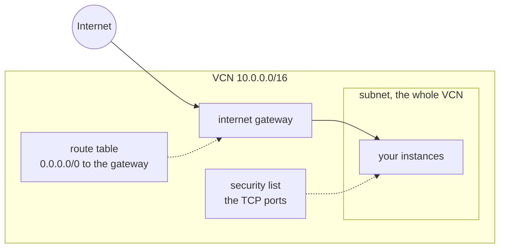

title: Oracle Cloud
order: 4
description: Buckets, files, images imported from them, networks and instances.
---

```scheme
(use-modules (chaudron) (chaudron oracle))
```

## Setup

Oracle signs each request with a key of yours, instead of a token. In the
[Oracle Cloud Console](https://cloud.oracle.com), open your profile, then
**Tokens and keys** (**API keys** on older consoles), **Add API key**,
**Generate API key pair**. Download the private key, then **Add**: Oracle
shows the values to copy.

```sh .env
OCI_USER=ocid1.user.oc1..…
OCI_TENANCY=ocid1.tenancy.oc1..…
OCI_FINGERPRINT=12:34:…
OCI_REGION=eu-paris-1
OCI_KEY_FILE=~/.oci/oci_api_key.pem
OCI_COMPARTMENT=ocid1.compartment.oc1..…
```

`OCI_COMPARTMENT` is where resources are made; without it, the root
compartment of the tenancy. A compartment of its own, made under
**Identity & Security**, **Compartments**, keeps them apart from the rest.
Keep the key out of version control, readable only by you: `chmod 600`.

## A complete example

```scheme deploy.scm
(with-stage "prod"
  (define files (oracle-bucket "files" #:public? #t))
  (oracle-object "index.html" #:bucket files #:file "public/index.html")

  (define net (oracle-network "net" #:ports '(22 80 443)))

  (define web
    (oracle-instance "web"
                     #:network net
                     #:shape "VM.Standard.A1.Flex" #:ocpus 1 #:memory 6
                     #:ssh-public-key-file "~/.ssh/id_ed25519.pub"))

  (format #t "ssh ubuntu@~a~%" (output web 'ipv4)))
```

## What every resource shares

- **Names.** At Oracle, a resource is named after its resource name and its
  stage, `web-prod` for `web` in `"prod"`. `#:name` sets another name.
- **Compartment.** `#:compartment` makes it in another compartment than
  `OCI_COMPARTMENT`.

## oracle-bucket

An Object Storage bucket.

| Argument | Default | |
|---|---|---|
| `#:public?` | `#f` | anyone can read its objects |
| `#:compartment`, `#:name` | | see above |

Outputs: `id`, `name`, `namespace`. Everything changes in place, the name
too. A bucket must be empty to be deleted: chaudron deletes the objects it
declares first, but not files put there by other means.

## oracle-object

A file in a bucket.

| Argument | Default | |
|---|---|---|
| `#:bucket` | required | its [bucket](#oracle-bucket) |
| `#:file` | required | the file to send |
| `#:name` | the resource name | its name in the bucket, not suffixed with the stage |

Outputs: `id`, `name`, `bucket`, `namespace`, `sha256`.

The file is sent again when its content changes, and when the object was
changed behind chaudron's back: its SHA-256 is kept in the object's
metadata. Files over 64 MiB are sent in parts. Sending is as fast as your
upload: at 1 Mbit/s, a 500 MB disk image takes more than an hour. A public
object is at
`https://objectstorage.REGION.oraclecloud.com/n/NAMESPACE/b/BUCKET/o/NAME`.

## oracle-image

A custom image, imported from a QCOW2 disk image in a bucket, for
instances to start from.

| Argument | Default | |
|---|---|---|
| `#:object` | required | the [object](#oracle-object) holding the disk image |
| `#:shapes` | `'()` | the shapes that can start from it, such as `'("VM.Standard.A1.Flex")` |
| `#:firmware` | `"UEFI_64"` | or `"BIOS"`; Arm shapes only have UEFI |
| `#:launch-mode` | `"PARAVIRTUALIZED"` | how Oracle presents disks and network to it |
| `#:operating-system` | `"Linux"` | shown by Oracle |
| `#:compartment`, `#:name` | | see above |

Outputs: `id`. Importing takes a few minutes, more for large images. The
image is imported again when the object's content changes. Shapes and the
name change in place.

## oracle-network

A virtual cloud network, with what instances need to be reached: an
internet gateway, a route to it, a subnet covering the whole network, and
rules letting anyone reach some TCP ports.



| Argument | Default | |
|---|---|---|
| `#:cidr` | `"10.0.0.0/16"` | its addresses |
| `#:ports` | `'(22)` | the TCP ports open to anyone |
| `#:compartment`, `#:name` | | see above |

Outputs: `id`, the subnet given to instances, and `vcn-id`, `subnet-id`,
`internet-gateway-id`, `route-table-id`, `security-list-id`. Ports and the
name change in place; changing the CIDR replaces the network, and with it
its instances.

## oracle-instance

A virtual machine.

| Argument | Default | |
|---|---|---|
| `#:network` | required | its [network](#oracle-network) |
| `#:shape` | `"VM.Standard.E2.1.Micro"` | its kind of machine |
| `#:ocpus`, `#:memory` | | for flexible shapes, such as `"VM.Standard.A1.Flex"`: OCPUs, and memory in GB |
| `#:image` | `"Canonical Ubuntu 24.04"` | the name of an Oracle image, whose latest version is taken, or an image ID, such as an [imported image](#oracle-image)'s `(output image 'id)` |
| `#:disk` | Oracle's | the size of its boot volume, in GB |
| `#:ssh-public-key-file` | none | the key let in; the user is `ubuntu` on Ubuntu |
| `#:user-data` | none | a cloud-init configuration, run on first boot |
| `#:availability-domain` | the first one | |
| `#:compartment`, `#:name` | | see above |

Outputs: `id`, `ipv4`, `private-ipv4`, `availability-domain`, `image-id`.

Changing the shape, the OCPUs or the memory restarts the instance, in
place. Changing what it is made from, its image, disk, network, key or
user data, replaces it. Its boot volume is deleted with it.

## oracle-guix-system

Guix System deployed with `guix deploy` to an instance started from a Guix
System image: an [image](#oracle-image) imported from the QCOW2 file of
`guix system image --image-type=qcow2-gpt`, for Arm shapes built with
`--system=aarch64-linux`.

| Argument | Default | |
|---|---|---|
| `#:instance` | required | the [instance](#oracle-instance) |
| `#:os` | required | a file whose last expression is an operating system |
| `#:identity` | `"~/.ssh/id_ed25519"` | the private key letting chaudron in as root |
| `#:build-locally?` | `#f` | build the system here and send it, rather than on the instance |

The image must let `#:identity` in as root, and trust this machine's Guix
signing key. The system is deployed again whenever the file, or the Guix
in use, changes. By default the instance builds it, fetching substitutes
from Guix's servers: sending a whole system from home takes long. Removing
it leaves the instance as it is.

> [!NOTE]
> Free instances, `VM.Standard.E2.1.Micro` and `VM.Standard.A1.Flex` up to
> 4 OCPUs and 24 GB, are often refused with `Out of host capacity`: Oracle
> has none left in the region for now. Try again later, or the other shape.
