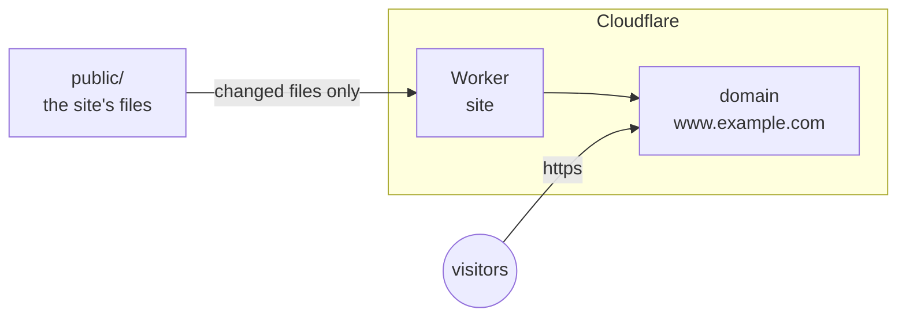

title: A static site on Cloudflare
order: 4
description: Serve a directory of files from Cloudflare, with HTTPS, and no server.
---

A Cloudflare Worker serves the files of a directory, at a domain of yours,
with HTTPS. There is no server to keep up to date, and each change of the
site publishes only the files that changed.

> [!NOTE]
> Tested on Cloudflare with this very site: deployed in about twelve
> seconds, served over HTTPS a few seconds later.



## What you need

A Cloudflare token with **Workers Scripts: Edit**, and **DNS: Edit** on the
zone of the domain; see [Cloudflare](/docs/cloudflare/#setup). The files to
serve are in `public/`.

## The program

```scheme deploy.scm
(use-modules (chaudron)
             (chaudron cloudflare)
             (ice-9 match))

(load-env-file ".env")

(define (deploy)
  (with-stage "prod"
    (let ((site (cloudflare-worker "site"
                                   #:assets "public"
                                   #:domain "www.example.com")))
      (format #t "~a~%" (output site 'url)))))

(match (command-line)
  ((_ "destroy") (destroy-stage "prod"))
  (_ (deploy)))
```

Since a deployment is a program, it can build the site first, with
`(system* "haunt" "build")` before `with-stage`, for instance.

## Run it

```sh
$ guile deploy.scm
```

```output
chaudron: create cloudflare-worker/site
https://www.example.com/
```

The site answers over HTTPS within a few seconds. Run it again: nothing
changes, nothing is uploaded.

## Update the site

Change a file in `public/`, and run it again:

```output
chaudron: update cloudflare-worker/site (assets)
https://www.example.com/
```

Only the files that changed are uploaded: one, here. The new version is
served at once.

## Without a domain

Leave out `#:domain`, and the Worker is served on its `workers.dev`
address, such as `https://site-prod.your-subdomain.workers.dev/`. Adding
or removing the domain later changes it in place.

## Clean up

```sh
$ guile deploy.scm destroy
```

```output
chaudron: delete cloudflare-worker/site
```

The domain goes along with the Worker.
