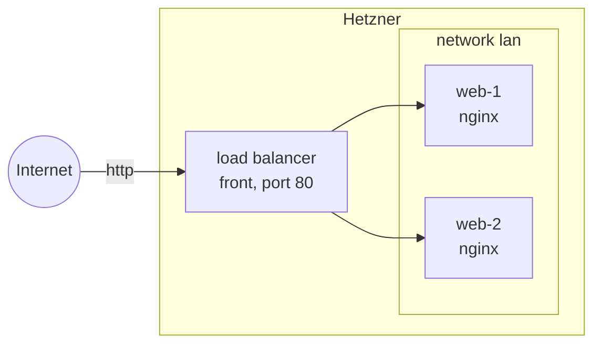

title: Web servers behind a load balancer
order: 1
description: Two Debian servers, reachable only through a load balancer, over a private network.
---

Two servers run nginx, set up by cloud-init. A load balancer shares the
traffic between them over a private network; the servers themselves only
accept SSH from outside.

> [!NOTE]
> Tested on Hetzner Cloud. It costs a few cents an hour while it runs.



## The program

```scheme deploy.scm
(use-modules (chaudron)
             (chaudron hetzner)
             (ice-9 match))

(load-env-file ".env")

;; Installs nginx, and makes it answer with the server's name.
(define %user-data "\
#cloud-config
packages: [nginx]
runcmd:
  - hostname > /var/www/html/index.html
")

(define (deploy dry-run?)
  (with-stage "demo" #:dry-run? dry-run?
    (define key
      (hetzner-ssh-key "me" #:public-key-file "~/.ssh/id_ed25519.pub"))

    (define lan (hetzner-network "lan"))

    (define ssh-only
      (hetzner-firewall "ssh-only" #:rules (list (allow-in 'tcp 22))))

    (define (web name)
      (hetzner-server name
                      #:type "cx23"
                      #:location "fsn1"
                      #:ssh-keys (list key)
                      #:firewalls (list ssh-only)
                      #:networks (list lan)
                      #:user-data %user-data))

    (define-values (web-1 web-2)
      (concurrently (web "web-1") (web "web-2")))

    (define front
      (hetzner-load-balancer "front"
                             #:location "fsn1"
                             #:services (list (forward 'http 80))
                             #:targets (list web-1 web-2)
                             #:network lan))

    (format #t "http://~a/~%" (output front 'ipv4))))

(match (command-line)
  ((_ "dry-run") (deploy #t))
  ((_ "destroy") (destroy-stage "demo"))
  (_ (deploy #f)))
```

- `web` is an ordinary procedure: both servers are declared the same way,
  and created at the same time by `concurrently`.
- With `#:network`, the load balancer reaches its targets through the
  private network, on their private addresses.
- Hetzner firewalls do not filter private networks: the firewall keeps the
  servers' port 80 closed to the Internet, not to the load balancer.

## Run it

```sh
$ guile deploy.scm
```

```output
chaudron: create hetzner-ssh-key/me
chaudron: create hetzner-network/lan
chaudron: create hetzner-firewall/ssh-only
chaudron: create hetzner-server/web-1
chaudron: create hetzner-server/web-2
chaudron: create hetzner-load-balancer/front
http://203.0.113.10/
```

It takes about half a minute. cloud-init then needs a minute or two to
install nginx on each server; until a server answers, the load balancer
leaves it out. Then the two take turns:

```sh
$ curl http://203.0.113.10/
web-2-demo
$ curl http://203.0.113.10/
web-1-demo
```

A server's own address does not answer on port 80.

## Clean up

```sh
$ guile deploy.scm destroy
```

```output
chaudron: delete hetzner-load-balancer/front
chaudron: delete hetzner-server/web-1
chaudron: delete hetzner-server/web-2
chaudron: delete hetzner-firewall/ssh-only
chaudron: delete hetzner-network/lan
chaudron: delete hetzner-ssh-key/me
```

The load balancer goes first, since it was given the servers, and the
network last but one, after everything attached to it.
