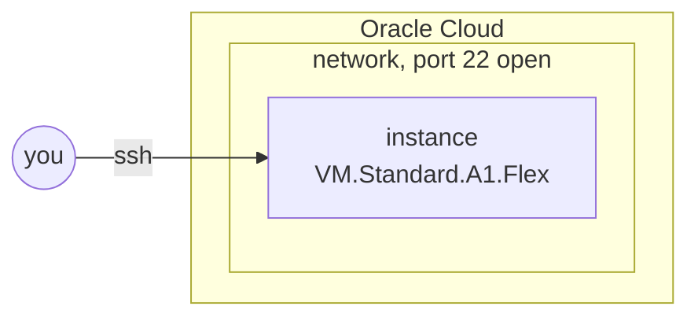

title: A free Arm server on Oracle Cloud
order: 7
description: An instance of Oracle's free tier, reachable over SSH, in a few lines.
---

Oracle's free tier includes Arm instances, `VM.Standard.A1.Flex`, up to 4
OCPUs and 24 GB in all. This recipe makes one, with 1 OCPU and 6 GB, in a
network of its own, and lets you in over SSH.

> [!NOTE]
> Tested on Oracle Cloud, in `eu-paris-1`: about thirty seconds until the
> instance runs, a minute more until SSH answers.



## What you need

The Oracle variables in `.env`, as in [Oracle Cloud](/docs/oracle/#setup),
and an SSH key.

## The program

```scheme deploy.scm
(use-modules (chaudron)
             (chaudron oracle)
             (ice-9 match))

(load-env-file ".env")

(define (deploy dry-run?)
  (with-stage "dev" #:dry-run? dry-run?
    (define net (oracle-network "net" #:ports '(22)))

    (define box
      (oracle-instance "box"
                       #:network net
                       #:shape "VM.Standard.A1.Flex" #:ocpus 1 #:memory 6
                       #:ssh-public-key-file "~/.ssh/id_ed25519.pub"))

    (format #t "ssh ubuntu@~a~%" (output box 'ipv4))))

(match (command-line)
  ((_ "dry-run") (deploy #t))
  ((_ "destroy") (destroy-stage "dev"))
  (_ (deploy #f)))
```

`oracle-network` makes everything an instance needs to be reached: the
network, an internet gateway, a route to it and the rule opening port 22.
The instance runs the latest Ubuntu 24.04, its user is `ubuntu`.

## Run it

```output
chaudron: create oracle-network/net
chaudron: create oracle-instance/box
ssh ubuntu@203.0.113.40
```

Run it again: nothing changes.

## Make it bigger

Change `#:memory 6` to `#:memory 8` and run it again:

```output
chaudron: update oracle-instance/box (memory)
```

The instance restarts with its new size, in place, in about two minutes;
it keeps its disk and its address.

## Out of host capacity

Free instances are often refused:

```output
chaudron: could not create oracle-instance/box: Out of host capacity.
```

Oracle has none left in the region for now. Nothing was made but the
network: run the program again later. `VM.Standard.E2.1.Micro`, the other
free shape, is refused just as often.

## Clean up

```sh
$ guile deploy.scm destroy
```

```output
chaudron: delete oracle-instance/box
chaudron: delete oracle-network/net
```

The instance goes first: a network cannot be deleted while an instance is
in it.
