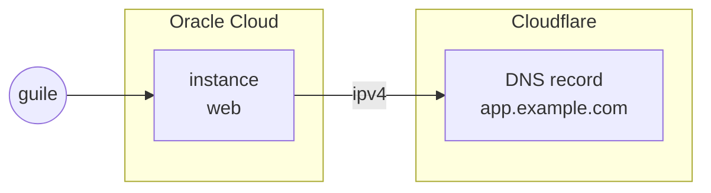

title: An Oracle server, named at Cloudflare
order: 8
description: Two providers in one program: the server's address goes to a DNS record.
---

A server at Oracle and its name at Cloudflare are two providers, and two
consoles. Here they are one program: the address Oracle gives the instance
is passed to the DNS record like any other value.

> [!NOTE]
> Checked with a dry run. The instance and the network were tested on
> Oracle Cloud, and the DNS record on Cloudflare, in the other recipes.



## What you need

The Oracle variables and `CLOUDFLARE_API_TOKEN` in `.env`, and a zone at
Cloudflare. See [Credentials](/docs/credentials/).

## The program

```scheme deploy.scm
(use-modules (chaudron)
             (chaudron oracle)
             (chaudron cloudflare)
             (ice-9 match))

(load-env-file ".env")

(define (deploy dry-run?)
  (with-stage "prod" #:dry-run? dry-run?
    ;; At Oracle: a network open to the web, and a server in it.
    (define net (oracle-network "net" #:ports '(22 80 443)))

    (define web
      (oracle-instance "web"
                       #:network net
                       #:shape "VM.Standard.A1.Flex" #:ocpus 1 #:memory 6
                       #:ssh-public-key-file "~/.ssh/id_ed25519.pub"))

    ;; At Cloudflare: its address under a name of yours.
    (define record
      (cloudflare-dns-record "app" #:zone "example.com"
                             #:content (output web 'ipv4)))

    (format #t "http://~a/~%" (output record 'name))))

(match (command-line)
  ((_ "dry-run") (deploy #t))
  ((_ "destroy") (destroy-stage "prod"))
  (_ (deploy #f)))
```

`(output web 'ipv4)` is the instance's public address, known once Oracle has
made it: the record is created after the instance, with it.

`guile deploy.scm dry-run` lists what it would make, without making
anything; `guile deploy.scm` makes it.

## When the address changes

If the instance is replaced, by changing its image for example, it gets a
new address. The record is declared after it, with the new address: the same
run updates it.
