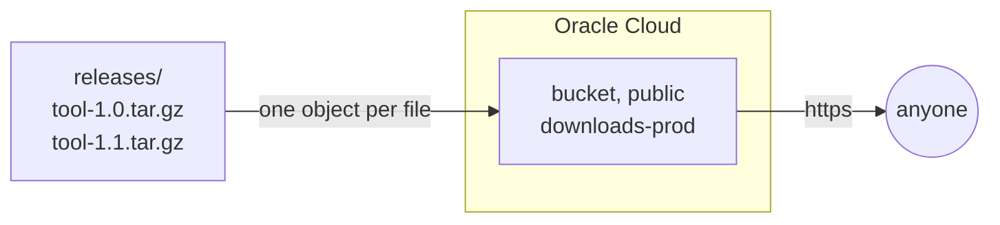

title: Files to download from a bucket
order: 10
description: A public Oracle bucket, with one object per file of a directory.
---

A public bucket serves its files to anyone, at a stable address: release
archives, images, datasets. Here, each file of `releases/` becomes an
object, with a loop: add a file and run the program, it is sent; remove it,
it is deleted.

```prereqs
Time: 5 minutes
Accounts: Oracle Cloud
Cost: the storage of your files, free within Oracle's free tier
You get: a public bucket, with one object per file of a directory
```

> [!NOTE]
> Checked with a dry run. Public buckets, and files sent and sent again,
> were tested on Oracle Cloud.



## The program

```scheme deploy.scm
(use-modules (chaudron)
             (chaudron oracle)
             (ice-9 ftw)
             (ice-9 match))

(load-env-file ".env")

(define (files directory)
  "The names of the files in DIRECTORY."
  (scandir directory (lambda (name) (not (string-prefix? "." name)))))

(define (deploy dry-run?)
  (with-stage "prod" #:dry-run? dry-run?
    (define downloads (oracle-bucket "downloads" #:public? #t))

    ;; One object per file of releases/.
    (for-each (lambda (name)
                (oracle-object name #:bucket downloads
                                    #:file (string-append "releases/" name)))
              (files "releases"))

    (format #t "https://objectstorage.~a.oraclecloud.com/n/~a/b/~a/o/~%"
            (getenv "OCI_REGION")
            (output downloads 'namespace)
            (output downloads 'name))))

(match (command-line)
  ((_ "dry-run") (deploy #t))
  ((_ "destroy") (destroy-stage "prod"))
  (_ (deploy #f)))
```

The program is ordinary Guile: `scandir` lists the directory, `for-each`
declares an object per file. Objects are named after the file, without the
stage: the bucket already has it, `downloads-prod`.

It prints the address of the bucket: each file is there, followed by its
name. `guile deploy.scm dry-run` lists what it would make, without making
anything; `guile deploy.scm` makes it.

## What to know

- A file is sent again only when its content changes, or when the object
  was changed by other means: its SHA-256 is kept in the object's metadata.
- Files over 64 MiB are sent in parts.
- Objects are served as `application/octet-stream`: browsers download them
  rather than show them. For a website, see
  [A static site on Cloudflare](/docs/cloudflare-static-site/).
- A bucket is deleted only once empty: the objects it holds that the
  program did not make stop its deletion.
