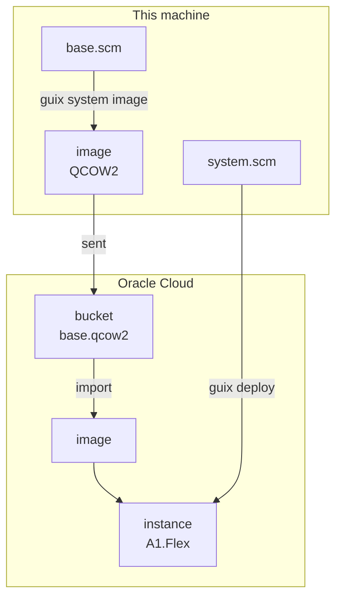

title: Guix System on Oracle Cloud
order: 9
description: Build a Guix System image, send it to a bucket, start an Arm instance from it, and deploy to it.
---

Oracle starts instances from images, and an image can come from a file in a
bucket. So the whole pipeline is a program: build the image of a minimal
Guix System, send it, import it, start an instance from it, then deploy
the real system with `guix deploy`, as often as you like.

> [!NOTE]
> Tested on Oracle Cloud with a `VM.Standard.A1.Flex` instance. Building the
> image takes about twelve minutes the first time, importing it about
> five.



## What you need

- The Oracle variables in `.env`, an SSH key, and a Guix signing key, made
  once with `guix archive --generate-key`.
- To build an Arm image on an x86 machine, Guix needs to run Arm programs:
  on Guix System, add QEMU to your system's services, then reconfigure:

  ```scheme
  (service qemu-binfmt-service-type
           (qemu-binfmt-configuration
            (platforms (lookup-qemu-platforms "aarch64"))))
  ```

## The base system

The image: just enough to boot on Oracle's Arm instances, let you in as
root, and accept what this machine sends with `guix deploy`.

```scheme base.scm
(use-modules (gnu) (gnu packages linux) (guix gexp))
(use-service-modules networking ssh)

(operating-system
  (host-name "guix")
  (timezone "Etc/UTC")
  (bootloader (bootloader-configuration
               (bootloader grub-efi-bootloader)
               (targets '("/boot/efi"))))
  ;; Oracle shows the serial console in the instance's console history.
  (kernel-arguments '("console=ttyAMA0"))
  (initrd-modules (cons* "virtio_scsi" "sd_mod"
                         (base-initrd-modules linux-libre)))
  (file-systems (cons (file-system
                        (mount-point "/")
                        (device (file-system-label "Guix_image"))
                        (type "ext4"))
                      %base-file-systems))
  (services
   (cons* (service dhcpcd-service-type)
          (service openssh-service-type
                   (openssh-configuration
                    (permit-root-login 'prohibit-password)
                    (authorized-keys
                     `(("root" ,(local-file
                                 (string-append (getenv "HOME")
                                                "/.ssh/id_ed25519.pub")
                                 "me.pub"))))))
          (modify-services %base-services
            ;; Accept what this machine sends with 'guix deploy'.
            (guix-service-type
             config => (guix-configuration
                        (inherit config)
                        (authorized-keys
                         (cons (local-file "/etc/guix/signing-key.pub"
                                           "signing-key.pub")
                               (guix-configuration-authorized-keys
                                config)))))))))
```

## The deployed system

What runs on the instance: the base system, plus what you add. It also
mounts the image's EFI partition, where `guix deploy` installs the
bootloader.

```scheme system.scm
(use-modules (gnu))
(use-package-modules admin)

(define %base (load "base.scm"))

(operating-system
  (inherit %base)
  (host-name "web")
  (packages (cons fastfetch-minimal (operating-system-packages %base)))
  (file-systems (cons (file-system
                        (mount-point "/boot/efi")
                        (device (file-system-label "GNU-ESP"))
                        (type "vfat"))
                      (operating-system-file-systems %base))))
```

Keep changes in `system.scm`: changing `base.scm` changes the image, which
is sent and imported again, and replaces the instance.

## The program

```scheme deploy.scm
(use-modules (chaudron)
             (chaudron command)
             (chaudron oracle)
             (ice-9 match))

(load-env-file ".env")

(define (image-file)
  "Build the image of base.scm for Oracle's Arm instances; return its file."
  (string-trim-right
   (invoke "guix" '("system" "image" "--system=aarch64-linux"
                    "--image-type=qcow2-gpt" "--image-size=20G" "base.scm")
           #:capture? #t)))

(define (deploy)
  (with-stage "prod"
    (define images (oracle-bucket "images"))
    (define disk (oracle-object "base.qcow2" #:bucket images
                                #:file (image-file)))
    (define base (oracle-image "base" #:object disk
                               #:shapes '("VM.Standard.A1.Flex")))
    (define net (oracle-network "net"))
    (define web
      (oracle-instance "web" #:network net #:image (output base 'id)
                       #:shape "VM.Standard.A1.Flex" #:ocpus 1 #:memory 6))
    (oracle-guix-system "web" #:instance web #:os "system.scm")
    (format #t "ssh root@~a~%" (output web 'ipv4))))

(match (command-line)
  ((_ "destroy") (destroy-stage "prod"))
  (_ (deploy)))
```

`guix system image` prints the file it made, in the store: the program gives
it to `oracle-object`. On later runs the image is already built, and the
object is only sent again if the file changed.

## Run it

```sh
$ guile deploy.scm
```

```output
chaudron: create oracle-bucket/images
chaudron: create oracle-object/base.qcow2
chaudron: create oracle-image/base
chaudron: base-prod: importing the image, this takes a while
chaudron: create oracle-network/net
chaudron: create oracle-instance/web
chaudron: create oracle-guix-system/web
chaudron: 203.0.113.50: waiting for SSH
chaudron: 203.0.113.50: deploying /home/me/infra/system.scm
ssh root@203.0.113.50
```

The instance builds the system itself, fetching substitutes from Guix's
servers, rather than receiving it from this machine. Change `system.scm`
and run the program again: only the deployment runs.

## Two things learned while testing

- **Without the EFI partition mounted, the deployment fails** at its last
  step: `grub-install: error: failed to get canonical path of /boot/efi`.
  The system is activated, but the bootloader is not updated. Hence the
  file system in `system.scm`.
- **Imported images are taken as BIOS ones** by Oracle, and Arm instances
  only boot with UEFI: `oracle-image` sets the image to UEFI, its default
  `#:firmware`. With BIOS, the instance runs, but its console stays empty.
