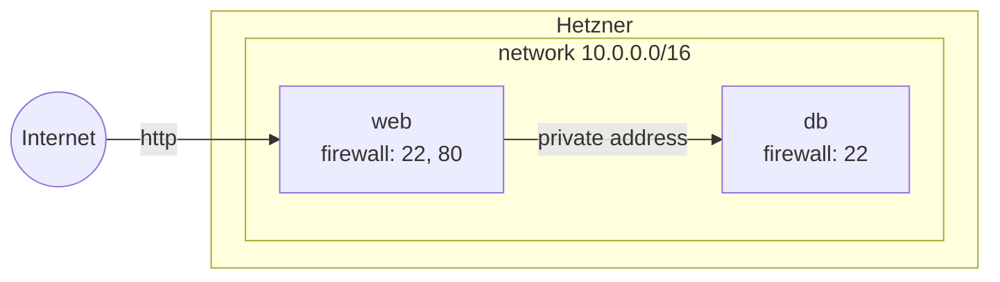

title: Two servers on a private network
order: 11
description: A web server and a database at Hetzner, talking over a private network the Internet cannot reach.
---

The web server is reached from the Internet; the database only from the web
server, over a private network. Each server has a firewall for its public
address, and an address on the network.

```prereqs
Time: 5 minutes
Accounts: Hetzner Cloud
Cost: a few cents an hour while the servers run
You get: a web server and a database talking over a private network
```

> [!NOTE]
> Checked with a dry run.



## The program

```scheme deploy.scm
(use-modules (chaudron)
             (chaudron hetzner)
             (ice-9 match))

(load-env-file ".env")

(define (deploy dry-run?)
  (with-stage "prod" #:dry-run? dry-run?
    (define key
      (hetzner-ssh-key "me" #:public-key-file "~/.ssh/id_ed25519.pub"))

    (define lan (hetzner-network "lan" #:ip-range "10.0.0.0/16"))

    ;; The web server is reached from the Internet on 22 and 80,
    (define public
      (hetzner-firewall "public" #:rules (list (allow-in 'tcp 22)
                                               (allow-in 'tcp 80))))

    ;; the database only on 22: it serves the web server over the network.
    (define ssh-only
      (hetzner-firewall "ssh-only" #:rules (list (allow-in 'tcp 22))))

    (define db
      (hetzner-server "db" #:type "cx23" #:location "fsn1"
                      #:ssh-keys (list key)
                      #:firewalls (list ssh-only)
                      #:networks (list lan)))

    (define web
      (hetzner-server "web" #:type "cx23" #:location "fsn1"
                      #:ssh-keys (list key)
                      #:firewalls (list public)
                      #:networks (list lan)))

    (format #t "web: ~a, database at ~a~%"
            (output web 'ipv4) (output db 'private-ipv4))))

(match (command-line)
  ((_ "dry-run") (deploy #t))
  ((_ "destroy") (destroy-stage "prod"))
  (_ (deploy #f)))
```

`(output db 'private-ipv4)` is the database's address on the network: give
it to the web server's configuration.

`guile deploy.scm dry-run` lists what it would make, without making
anything; `guile deploy.scm` makes it.

## What to know

- Hetzner's firewalls filter the public addresses only: traffic on the
  private network reaches every port. Keep the database's service listening
  on its private address, not on every address.
- The key, the network and the firewalls are made before the servers, which
  are given them; deleting goes the other way.
- To grow the network, widen `#:ip-range`: it changes in place, and can only
  grow.
