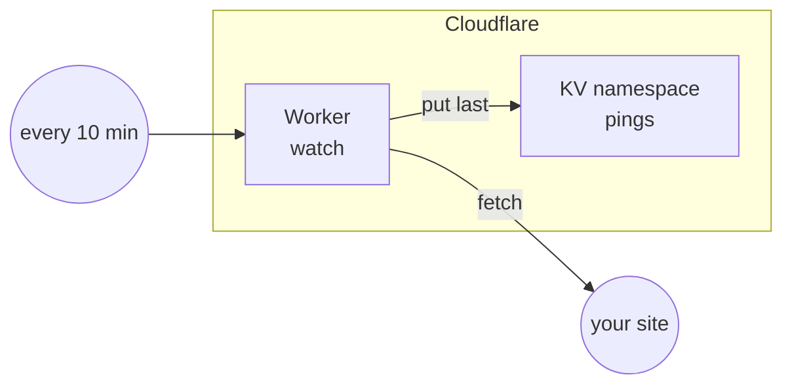

title: A Worker on a schedule
order: 14
description: Code run by Cloudflare every ten minutes, keeping what it finds in KV.
---

A Worker can run at set times, without a server: here it checks a site
every ten minutes, keeps the result in a KV namespace, and shows the last
one at its address.

> [!NOTE]
> Checked with a dry run. Schedules and KV bindings were tested on
> Cloudflare, see [An API on Workers](/docs/workers-api/).



## The code

```js worker.js
export default {
  // Every 10 minutes: is the site up?
  async scheduled(event, env) {
    const response = await fetch(env.SITE);
    await env.PINGS.put("last", JSON.stringify({
      at: new Date().toISOString(),
      status: response.status
    }));
  },
  // On request: the last check.
  async fetch(request, env) {
    return new Response(await env.PINGS.get("last") ?? "{}", {
      headers: { "content-type": "application/json" }
    });
  }
};
```

## The program

```scheme deploy.scm
(use-modules (chaudron)
             (chaudron cloudflare)
             (ice-9 match))

(load-env-file ".env")

(define (deploy dry-run?)
  (with-stage "prod" #:dry-run? dry-run?
    (define pings (cloudflare-kv-namespace "pings"))

    ;; Every 10 minutes, the Worker checks the site and keeps the result.
    (define watch
      (cloudflare-worker "watch"
                         #:script "worker.js"
                         #:vars '(("SITE" . "https://www.example.com/"))
                         #:bindings (list (kv-binding "PINGS" pings))
                         #:crons '("*/10 * * * *")))

    (format #t "~a~%" (output watch 'url))))

(match (command-line)
  ((_ "dry-run") (deploy #t))
  ((_ "destroy") (destroy-stage "prod"))
  (_ (deploy #f)))
```

`#:crons` takes cron expressions, in UTC. Changing them only changes when
the Worker runs; changing the code publishes it again.


Once made, the Worker answers at its `workers.dev` address with the last
check. `guile deploy.scm dry-run` lists what it would make, without making
anything; `guile deploy.scm` makes it.
