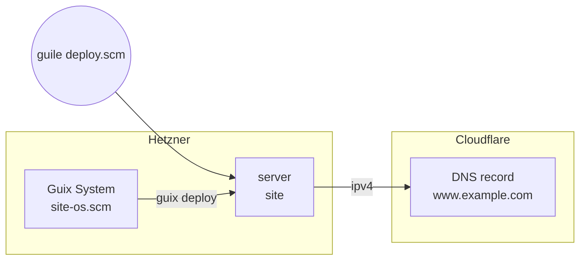

title: A static site on Guix System
order: 6
description: A Hetzner server running Guix System, nginx serving your files, and a DNS record.
---

A server, Guix System installed on it, nginx serving a directory of files,
and a Cloudflare record pointing to it. This is how chaudron's own site
was tested.

> [!NOTE]
> Tested on Hetzner Cloud and Cloudflare: about eight minutes from nothing
> to the site answering, most of it installing Guix System.



## What you need

Besides the tokens, the [Guix System](/docs/guix-system/) requirements:
`guix`, `ssh`, and a Guix signing key. The files to serve are in `public/`,
next to the programs.

## The system

```scheme site-os.scm
(use-modules (gnu)
             (gnu machine hetzner))
(use-service-modules web)

(define %base
  (make-hetzner-os "cx23"))

(operating-system
  (inherit %base)
  (host-name "site")
  (services
   (cons* (service nginx-service-type
                   (nginx-configuration
                    (server-blocks
                     (list (nginx-server-configuration
                            (listen '("80" "[::]:80"))
                            ;; The site is copied to the store with the system.
                            (root (local-file "public" "site"
                                              #:recursive? #t)))))))
          (operating-system-user-services %base))))
```

`local-file` copies `public/` into the store, along with the system: the
server needs nothing else.

## The deployment

```scheme deploy.scm
(use-modules (chaudron)
             (chaudron hetzner)
             (chaudron cloudflare)
             (ice-9 match))

(load-env-file ".env")

(define (deploy dry-run?)
  (with-stage "site" #:dry-run? dry-run?
    (define key
      (hetzner-ssh-key "me" #:public-key-file "~/.ssh/id_ed25519.pub"))

    (define web
      (hetzner-firewall "web" #:rules (list (allow-in 'tcp 22)
                                            (allow-in 'tcp 80))))

    (define server
      (hetzner-server "site"
                      #:type "cx23"
                      #:location "fsn1"
                      #:ssh-keys (list key)
                      #:firewalls (list web)))

    (hetzner-guix-system "site"
                         #:server server
                         #:os "site-os.scm"
                         #:ssh-key key)

    (cloudflare-dns-record "www"
                           #:zone "example.com"
                           #:content (output server 'ipv4))))

(match (command-line)
  ((_ "dry-run") (deploy #t))
  ((_ "destroy") (destroy-stage "site"))
  (_ (deploy #f)))
```

## Run it

```sh
$ guile deploy.scm
```

```output
chaudron: create hetzner-ssh-key/me
chaudron: create hetzner-firewall/web
chaudron: create hetzner-server/site
chaudron: create hetzner-guix-system/site
chaudron: 203.0.113.30: erasing its disk to install Guix System
chaudron: 203.0.113.30: booting the rescue system
chaudron: 203.0.113.30: waiting for SSH
chaudron: 203.0.113.30: installing Guix System, this takes a while
chaudron: 203.0.113.30: rebooting into Guix System
chaudron: 203.0.113.30: waiting for SSH
chaudron: 203.0.113.30: deploying /home/me/site/site-os.scm
chaudron: create cloudflare-dns-record/www
```

The site then answers at the server's address and at `www.example.com`.

## Updating the site

Two things to know, both seen while testing this recipe:

1. **Changing the files in `public/` is not enough.** chaudron deploys
   again when `site-os.scm` or the Guix in use changes, and only compares
   the content of `site-os.scm`. Edit it too; changing a comment is enough:

   ```output
   chaudron: update hetzner-guix-system/site (configuration)
   chaudron: 203.0.113.30: deploying /home/me/site/site-os.scm
   ```

2. **nginx keeps serving the old files.** Like `guix system reconfigure`,
   `guix deploy` does not restart services that are running. Restart it:

   ```sh
   $ ssh root@203.0.113.30 herd restart nginx
   ```

## Clean up

```sh
$ guile deploy.scm destroy
```

```output
chaudron: delete cloudflare-dns-record/www
chaudron: delete hetzner-guix-system/site
chaudron: delete hetzner-server/site
chaudron: delete hetzner-firewall/web
chaudron: delete hetzner-ssh-key/me
```
