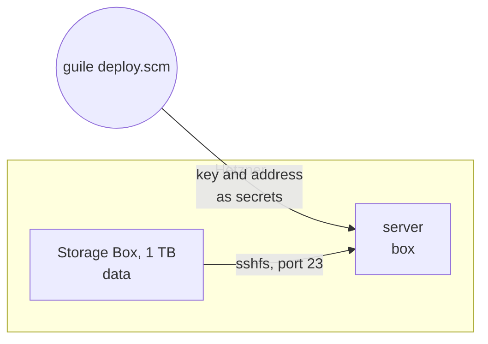

title: A Storage Box on Guix System
order: 13
description: A Storage Box of 1 TB mounted on a Guix System server with sshfs, its key kept out of the store.
---

A [volume](/docs/volume/) is fast but costly per gigabyte; a Storage Box
is a terabyte for the price of a few volume gigabytes, reached over the
network. Here a Guix System server mounts one on `/mnt/storage-box` with
sshfs, using a key that chaudron copies to the server outside of the store.

```prereqs
Time: 15 minutes, most of it waiting for Guix System to install
Accounts: Hetzner Cloud
Also needs: `guix`, `ssh`, and a Guix signing key
Cost: a few cents an hour for the server, and a few euros a month for the Storage Box
You get: a 1 TB Storage Box mounted on a Guix System server
```

> [!NOTE]
> Checked with a dry run, and the system with `guix system build`.



## What you need

Besides the token, the [Guix System](/docs/guix-system/) requirements, and
two things for the Storage Box:

```sh
ssh-keygen -t ed25519 -N "" -f storage-box-key   # the key the server uses
```

```sh .env
HCLOUD_TOKEN=…
STORAGE_BOX_PASSWORD=…
```

The password must have 12 characters or more, with an upper case letter, a
lower case letter, a digit and a special character. Keep `.env` and
`storage-box-key` out of version control.

## The system

```scheme box-os.scm
(use-modules (gnu)
             (gnu machine hetzner)
             (gnu packages linux)
             (gnu packages ssh)
             (gnu services linux)
             (gnu services shepherd))

(define %base
  (make-hetzner-os "cx23"))

;; Mount the Storage Box with sshfs, as told by the files of #:secrets.
(define storage-box
  (shepherd-service
   (provision '(storage-box))
   (requirement '(networking kernel-module-loader))
   (documentation "Mount the Storage Box on /mnt/storage-box.")
   (start #~(make-forkexec-constructor
             (list #$(file-append sshfs "/bin/sshfs") "-f"
                   "storage-box:" "/mnt/storage-box"
                   "-F" "/root/.ssh/storage-box.conf"
                   "-o" (string-append "ssh_command="
                                       #$(file-append openssh "/bin/ssh"))
                   "-o" "reconnect,ServerAliveInterval=15,ServerAliveCountMax=3"
                   "-o" "allow_other")
             #:log-file "/var/log/storage-box.log"))
   (stop #~(make-kill-destructor))))

(operating-system
  (inherit %base)
  (host-name "box")
  (services
   (cons* (simple-service 'storage-box shepherd-root-service-type
                          (list storage-box))
          (simple-service 'fuse kernel-module-loader-service-type '("fuse"))
          (simple-service 'storage-box-directory activation-service-type
                          #~(for-each (lambda (directory)
                                        (unless (file-exists? directory)
                                          (mkdir directory)))
                                      '("/mnt" "/mnt/storage-box")))
          (operating-system-user-services %base))))
```

The system says nothing of which Storage Box to mount: sshfs finds it in
`/root/.ssh/storage-box.conf`, a file chaudron copies to the server.

## The program

```scheme deploy.scm
(use-modules (chaudron)
             (chaudron hetzner)
             (ice-9 match)
             (ice-9 textual-ports))

(load-env-file ".env")

(define (ssh-config box)
  "Write how the server reaches BOX: sshfs reads it there."
  (call-with-output-file "storage-box.conf"
    (lambda (port)
      (format port "Host storage-box
  HostName ~a
  User ~a
  Port 23
  IdentityFile /root/.ssh/storage-box
  StrictHostKeyChecking accept-new
  BatchMode yes
" (output box 'server) (output box 'username))))
  "storage-box.conf")

(define (deploy dry-run?)
  (with-stage "prod" #:dry-run? dry-run?
    (define key
      (hetzner-ssh-key "me" #:public-key-file "~/.ssh/id_ed25519.pub"))

    (define server
      (hetzner-server "box" #:type "cx23" #:location "fsn1"
                      #:ssh-keys (list key)))

    ;; 1 TB, reachable over SSH from Hetzner's servers only.
    (define box
      (hetzner-storage-box "data"
                           #:type "bx11"
                           #:location "fsn1"
                           #:password (getenv "STORAGE_BOX_PASSWORD")
                           #:ssh-keys (list (string-trim-both
                                             (call-with-input-file
                                                 "storage-box-key.pub"
                                               get-string-all)))
                           #:ssh? #t
                           #:protected? #t))

    (hetzner-guix-system "box"
                         #:server server
                         #:os "box-os.scm"
                         #:ssh-key key
                         #:secrets `(("/root/.ssh/storage-box"
                                      . "storage-box-key")
                                     ("/root/.ssh/storage-box.conf"
                                      . ,(ssh-config box))))

    (format #t "ssh root@~a, the Storage Box in /mnt/storage-box~%"
            (output server 'ipv4))))

(match (command-line)
  ((_ "dry-run") (deploy #t))
  ((_ "destroy") (destroy-stage "prod"))
  (_ (deploy #f)))
```

The Storage Box comes before the system, and the secrets are copied before
the system is deployed: when the `storage-box` service first starts, the
key and the address are there.

## What to know

- `#:protected? #t` keeps the Storage Box from being deleted, by chaudron
  too: `destroy` fails on it. Turn it off and run the program first.
- Changing the location of the Storage Box replaces it, losing its data;
  its type, a bigger `"bx21"` for instance, changes in place.
- The server and the Storage Box are in the same location, and the Storage
  Box is not reachable from outside Hetzner: add `#:external? #t` to reach
  it from elsewhere.
- Changing a secret copies it and deploys again, but does not restart the
  service: `herd restart storage-box` on the server.
- The service's log is in `/var/log/storage-box.log`.
