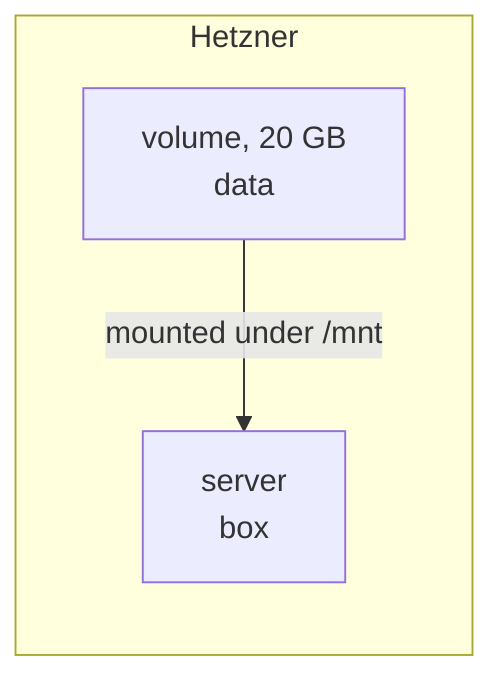

title: Data on a volume
order: 12
description: Keep data apart from the server's disk, so that replacing the server does not lose it.
---

A server's disk goes with the server: replace it, by changing its image or
its location, and the disk is gone. A volume is a disk of its own, given to
the server and mounted under `/mnt`; it outlives the server.

> [!NOTE]
> Checked with a dry run.



## The program

```scheme deploy.scm
(use-modules (chaudron)
             (chaudron hetzner)
             (ice-9 match))

(load-env-file ".env")

(define (deploy dry-run?)
  (with-stage "prod" #:dry-run? dry-run?
    (define key
      (hetzner-ssh-key "me" #:public-key-file "~/.ssh/id_ed25519.pub"))

    ;; The data lives on the volume, not on the server's disk.
    (define data (hetzner-volume "data" #:size 20 #:location "fsn1"))

    (define box
      (hetzner-server "box" #:type "cx23" #:location "fsn1"
                      #:image "debian-12"
                      #:ssh-keys (list key)
                      #:volumes (list data)))

    (format #t "ssh root@~a, data in ~a~%"
            (output box 'ipv4) (output data 'linux-device))))

(match (command-line)
  ((_ "dry-run") (deploy #t))
  ((_ "destroy") (destroy-stage "prod"))
  (_ (deploy #f)))
```

`guile deploy.scm dry-run` lists what it would make, without making
anything; `guile deploy.scm` makes it.

## What to know

- Changing the server's image or location replaces the server, losing the
  data on its disk, but not its volumes, which are given to the new one.
- `#:size` can only grow: make it bigger and run the program, the volume
  grows in place. The file system inside it is not grown: do it on the
  server, with `resize2fs` for ext4.
- The volume and the server must be in the same location.
