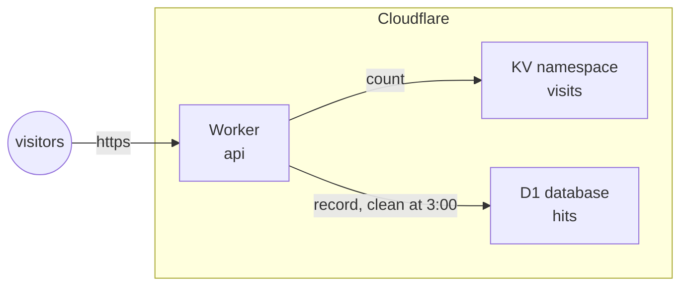

title: An API on Workers, with KV and D1
order: 5
description: A Worker counting visits in KV and recording them in a D1 database, with static files, a secret and a nightly cleanup.
---

A small API, and a page, served by one Worker with no server: it counts
visits in a KV namespace, records each in a D1 database, and cleans old
records every night.

```prereqs
Time: 10 minutes
Accounts: Cloudflare
Cost: nothing within the free plan
You get: an API and a page on a Worker, with KV, D1, and a nightly cleanup
```

> [!NOTE]
> Tested on Cloudflare. Workers, KV and D1 are free within the limits of
> the free plan.



## What you need

A Cloudflare token with, on the account, **Workers Scripts: Edit**,
**Workers KV Storage: Edit** and **D1: Edit**; see
[Cloudflare](/docs/cloudflare/#setup).

## The files

```project
@ deploy.scm | commit
The program: a KV namespace, a D1 database, and the Worker given both.
~~~ scheme
(use-modules (chaudron)
             (chaudron cloudflare)
             (ice-9 match))

(load-env-file ".env")

(define (deploy)
  (with-stage "prod"
    (define visits (cloudflare-kv-namespace "visits"))
    (define hits (cloudflare-d1-database "hits" #:schema "schema.sql"))
    (define api
      (cloudflare-worker "api"
                         #:script "worker.js"
                         #:assets "public"
                         #:vars '(("GREETING" . "hello"))
                         #:secrets '("API_KEY")
                         #:bindings (list (kv-binding "VISITS" visits)
                                          (d1-binding "DB" hits))
                         #:crons '("0 3 * * *")))
    (format #t "~a~%" (output api 'url))))

(match (command-line)
  ((_ "destroy") (destroy-stage "prod"))
  (_ (deploy)))
~~~
@ worker.js | commit
The code. `/api` counts and records a visit; `/about` reads a page from the static files; at 3 every night, records older than 30 days are deleted.
~~~ js
export default {
  async fetch(request, env) {
    const url = new URL(request.url);
    if (url.pathname === "/api") {
      const visits = Number(await env.VISITS.get("count") ?? 0) + 1;
      await env.VISITS.put("count", String(visits));
      await env.DB.prepare("INSERT INTO hits (path, at) VALUES (?, datetime('now'))")
        .bind(url.pathname).run();
      const { total } = await env.DB.prepare("SELECT count(*) AS total FROM hits").first();
      return Response.json({ greeting: env.GREETING, visits, hits: total,
                             key: env.API_KEY.length });
    }
    if (url.pathname === "/about") {
      return env.ASSETS.fetch(new URL("/index.html", request.url));
    }
    return new Response("not found", { status: 404 });
  },
  async scheduled(event, env) {
    await env.DB.prepare("DELETE FROM hits WHERE at < datetime('now', '-30 days')").run();
  }
};
~~~
@ schema.sql | commit
The tables of the database, run when it is created and whenever this file changes.
~~~ sql
CREATE TABLE IF NOT EXISTS hits (path TEXT, at TEXT);
CREATE INDEX IF NOT EXISTS hits_at ON hits (at);
~~~
@ public/ | commit
The static files, served as they are, and readable by the code as `env.ASSETS`.
@ public/index.html | commit
A page, served at `/`, and at `/about` by the code.
~~~
<h1>About this API</h1>
~~~
@ .env | secret
The Cloudflare token, and the API key given to the code as a secret: it never goes in chaudron's state.
~~~ sh
CLOUDFLARE_API_TOKEN=...
API_KEY=...
~~~
```

## Run it

```sh
$ guile deploy.scm
```

```output
chaudron: create cloudflare-kv-namespace/visits
chaudron: create cloudflare-d1-database/hits
chaudron: create cloudflare-worker/api
https://api-prod.your-subdomain.workers.dev/
```

The database and the namespace are created first: the Worker is given
them. After a few seconds:

```sh
$ curl https://api-prod.your-subdomain.workers.dev/api
{"greeting":"hello","visits":1,"hits":1,"key":19}
$ curl https://api-prod.your-subdomain.workers.dev/api
{"greeting":"hello","visits":2,"hits":2,"key":19}
$ curl https://api-prod.your-subdomain.workers.dev/about
<h1>About this API</h1>
```

`key` is the length of the secret: the code has it, chaudron's state does
not.

## Change it

- Change the greeting, the code, a file or the secret, and run it again:
  the Worker is published again.
- Add a table to `schema.sql` with `CREATE TABLE IF NOT EXISTS`: the
  schema is run again. Statements that cannot run twice, such as
  `ALTER TABLE`, do not belong there; see
  [D1 databases](/docs/cloudflare/#cloudflare-d1-database).
- Retitle the namespace with `#:title`: it is renamed in place, and the
  count goes on.

## Clean up

```sh
$ guile deploy.scm destroy
```

```output
chaudron: delete cloudflare-worker/api
chaudron: delete cloudflare-d1-database/hits
chaudron: delete cloudflare-kv-namespace/visits
```

The Worker goes first, since it was given the others. The database is
deleted with its data.
